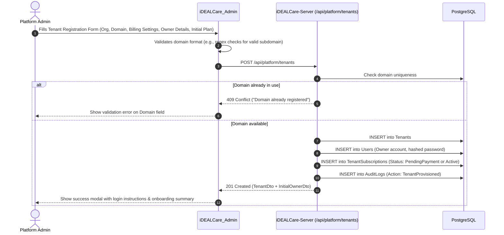
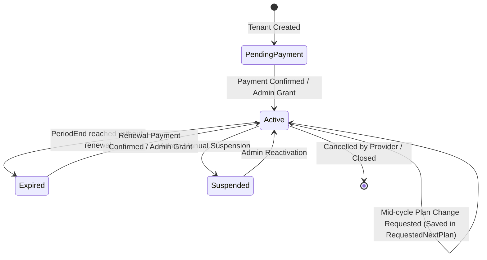

# iDEALCare_Admin — Architecture & Implementation Plan
**Platform Administration Console for iDEAL Care SaaS**
*Document Version: 1.0 — October 2026*

---

## 1. Executive Summary & Objective

`iDEALCare_Admin` is the dedicated administrative portal for **iDEAL Smart Solution** internal operations personnel. While `iDEALCare-Web` serves tenant-specific clinics, staff, patients, and guardians within isolated subdomains, `iDEALCare_Admin` is the cross-tenant command center responsible for:

1. **Tenant Onboarding & Lifecycle Management**: Provisioning new healthcare providers, configuring custom domains, creating initial tenant owners, and maintaining operational status (active/suspended).
2. **Tenant Subscription & Plan Management**: Managing subscription tiers (Monthly/Yearly), enforcing subscription lifecycles, handling scheduled plan changes, processing manual/offline renewals, and tracking platform revenue.
3. **Platform Governance & Audit**: Monitoring cross-tenant security events, sensitive mutations, and system health.

---

## 2. Reference to Backend Architecture & Specification

The plan is built directly upon the architecture established in `iDEALCare-Server` and the **Product Requirements Specification (PRS v1.1)**:

### 2.1 Key PRS & Architectural Foundations
- **PRS Part II (§4–§6)**: Healthcare providers operate as isolated tenants and do not own the platform. Platform Administrators (`User.TenantId IS NULL`) have global scope and operate independently of individual tenant boundaries.
- **PRS Part XI (§79–§96)**:
  - Subscriptions are strictly **tenant-level** (never per-user or per-patient).
  - **No mid-cycle plan changes (§82)**: Changing billing frequency (Monthly ↔ Yearly) is deferred as a `PlanChangeRequest` and only takes effect at `PeriodEnd`.
  - **Subscription Expiry (§86–§87)**: Expired subscriptions restrict operational access via server-side middleware, but **never delete or truncate historical patient, care, or financial data**.
  - **Separation of Payments (§89)**: Subscription payments (`SubscriptionPayment`) are tracked completely separately from patient care payments (`Payment`).
- **PRS Addendum A (§A.1–§A.2)**: Platform admin accounts have no tenant domain. Platform authentication occurs via `/api/platform/auth/login` using email and password alone.
- **Backend Middleware Bypasses**:
  - `TenantResolutionMiddleware`: Requests matching `/api/platform/**` bypass tenant resolution.
  - `SubscriptionEnforcementMiddleware`: Requests matching `/api/platform/**` bypass subscription blocking.
- **Authorization Guard**: Platform admin endpoints are guarded by `[Authorize(Policy = "PlatformAdmin")]` verifying the `PlatformAdmin` role claim.

---

## 3. System Architecture & End-to-End Flow

```
+-------------------------------------------------------------------------+
|                           iDEALCare_Admin (React 19)                    |
|                                                                         |
|  +-------------------+  +--------------------+  +--------------------+  |
|  |  Platform Auth    |  | Tenant Management  |  | Subscription Engine|  |
|  |  - Direct Login   |  | - Onboarding Wizard|  | - Plan Catalog     |  |
|  |  - JWT Bearer     |  | - Domain Registry  |  | - Period Control   |  |
|  |  - Role Guard     |  | - Admin Provision  |  | - Next-Plan Queue  |  |
|  +---------+---------+  +---------+----------+  +---------+----------+  |
|            |                      |                       |             |
+------------|----------------------|-----------------------|-------------+
             |                      |                       |
             v                      v                       v
      HTTPS / JSON            HTTPS / JSON            HTTPS / JSON
             |                      |                       |
+------------v----------------------v-----------------------v-------------+
|                           iDEALCare-Server                              |
|                                                                         |
|  +-------------------------------------------------------------------+  |
|  |  Route: /api/platform/** (Bypasses Tenant & Subscription Gates)   |  |
|  +-------------------------------------------------------------------+  |
|  |  Controllers: PlatformAuthController, PlatformTenantsController,   |  |
|  |               PlatformSubscriptionsController, AuditLogsController |  |
|  +-------------------------------------------------------------------+  |
|  |  Application: PlatformTenantService, PlatformSubscriptionService  |  |
|  +-------------------------------------------------------------------+  |
|  |  Core & Infrastructure: Tenant, User, TenantSubscription,        |  |
|  |                          SubscriptionPlan, SubscriptionPayment    |  |
|  +-------------------------------------------------------------------+  |
|                                   |                                     |
|                                   v                                     |
|                         PostgreSQL (ideal_care_db)                      |
+-------------------------------------------------------------------------+
```

---

## 4. Backend Platform API Contract

While the backend currently features `PlatformAuthController` (`/api/platform/auth/login`) and `AuditLogsController` (`/api/platform/audit-logs`), the platform admin portal requires dedicated platform endpoints. 

Following the strict layering guidelines in `iDEALCare-Server/AGENTS.md` (Controllers → Application Service → `IRepository<T>` + `ISpecification<T>`), the following endpoints are planned:

### 4.1 Authentication & Profile
- `POST /api/platform/auth/login` *(Already implemented)*
  - **Request**: `{ email: string, password: string }`
  - **Response**: `{ accessToken: string, expiresAt: string, user: { id: string, firstName: string, lastName: string, email: string } }`
- `GET /api/platform/auth/me`
  - Returns current platform admin profile details.

### 4.2 Tenant Onboarding & Management
- `GET /api/platform/tenants`
  - Query params: `page`, `pageSize`, `search`, `isActive`, `subscriptionStatus`
  - Returns paginated list of tenants with their active domain, status, and subscription summary.
- `GET /api/platform/tenants/{id}`
  - Returns full tenant details: contact info, billing configuration, primary owner details, active subscription details, and operational statistics.
- `POST /api/platform/tenants` *(Tenant Registration Wizard)*
  - **Request**:
    ```json
    {
      "name": "Grace Nursing Home",
      "legalName": "Grace Healthcare Services Ltd",
      "domain": "gracecare.idealcare.ng",
      "email": "contact@gracecare.ng",
      "phoneNumber": "+2348012345678",
      "address": "14 Medical Crescent",
      "city": "Ikeja",
      "state": "Lagos",
      "country": "Nigeria",
      "initialPlanId": "d9b2...",
      "billingFrequency": 1, 
      "owner": {
        "firstName": "Ade",
        "lastName": "Balogun",
        "email": "admin@gracecare.ng",
        "password": "TemporaryPassword123!"
      },
      "nursingCareBillsRefundableByDefault": false,
      "registrationFeeAmount": 15000.00
    }
    ```
  - **Behavior**:
    - Validates domain uniqueness (case-insensitive).
    - Provisions `Tenant` entity.
    - Creates initial Owner user with `TenantRole.Owner` and `TenantId = tenant.Id`.
    - Creates initial `TenantSubscription` row with status `PendingPayment` or `Active` (if trial/complimentary).
    - Writes immutable record to `AuditLog`.
- `PUT /api/platform/tenants/{id}`
  - Updates profile metadata, contact info, billing defaults (`RegistrationFeeAmount`, `NursingCareBillsRefundableByDefault`).
- `PATCH /api/platform/tenants/{id}/status`
  - **Request**: `{ "isActive": boolean, "reason": string }`
  - Activates or suspends a tenant immediately.

### 4.3 Subscription Plans Catalog
- `GET /api/platform/subscription-plans`
  - Returns list of configured tiers: Name, BillingFrequency (Monthly = 1, Yearly = 2), Price, Currency, Active status.
- `POST /api/platform/subscription-plans`
  - Creates a new subscription plan tier.
- `PUT /api/platform/subscription-plans/{id}`
  - Modifies plan name, pricing, or description.
- `PATCH /api/platform/subscription-plans/{id}/status`
  - Toggles `isActive`.

### 4.4 Tenant Subscription Operations (PRS Part XI)
- `GET /api/platform/tenants/{id}/subscription`
  - Returns current plan, current period start/end, status, and any `RequestedNextPlan` queued for period expiration.
- `GET /api/platform/tenants/{id}/subscription/history`
  - Returns full audit log of previous subscription periods and renewals.
- `POST /api/platform/tenants/{id}/subscription/grant`
  - Manual admin subscription grant or extension (used for offline wire transfers, annual upfront contract invoicing, or trial grants).
  - **Request**:
    ```json
    {
      "planId": "guid",
      "billingFrequency": 2,
      "durationMonths": 12,
      "paymentReference": "OFFLINE-TRF-20261018",
      "notes": "Annual corporate wire transfer cleared"
    }
    ```
- `POST /api/platform/tenants/{id}/subscription/cancel-next-plan`
  - Cancels a pending next-cycle plan change request if requested by the tenant.
- `GET /api/platform/subscriptions/payments`
  - Cross-tenant subscription transaction log (Paystack references, amounts, dates, status).

### 4.5 System Audit & Governance
- `GET /api/platform/audit-logs` *(Already implemented)*
  - Query audit trails by `tenantId`, `actorUserId`, `resourceType`, `from`, `to`, `page`, `pageSize`.
- `GET /api/platform/dashboard/metrics`
  - High-level telemetry: Total Tenants, Active Subscriptions, Expiring in 7 Days, MRR (Monthly Recurring Revenue), Platform ARR.

---

## 5. `iDEALCare_Admin` Frontend Architecture

### 5.1 Technology Stack
- **Framework**: React 19 + TypeScript + Vite
- **Routing**: React Router 7 (`BrowserRouter`, `Routes`, `Route`, `Navigate`)
- **State Management**: Zustand (lightweight stores: `platformAuthStore`, `tenantFilterStore`)
- **API Client**: Axios (single instance with interceptors in `src/lib/apiClient.ts`)
- **Design System**: Vanilla CSS tokens in `src/index.css` (custom properties supporting Dark & Light mode, high-contrast healthcare data tables, dashboard metric cards, glassmorphic header/sidebar, and accessible forms).

### 5.2 Folder Structure

```
iDEALCare_Admin/
├── src/
│   ├── api/                     # One service per backend platform module
│   │   ├── platformAuthApi.ts
│   │   ├── platformTenantsApi.ts
│   │   ├── platformSubscriptionsApi.ts
│   │   └── platformAuditApi.ts
│   ├── components/              # Shared presentational UI
│   │   ├── Badge.tsx            # Status pills (Active, Expired, Suspended)
│   │   ├── Button.tsx
│   │   ├── Card.tsx
│   │   ├── DataTable.tsx        # Sortable, paginated data table
│   │   ├── Modal.tsx
│   │   └── MetricCard.tsx       # KPI summary card with trend indicator
│   ├── layouts/
│   │   ├── AdminLayout.tsx      # Sidebar, top navbar, notifications, breadcrumb
│   │   └── AuthLayout.tsx       # Centered login canvas
│   ├── lib/
│   │   ├── apiClient.ts         # Axios instance + JWT header injection + 401 handler
│   │   ├── authStorage.ts       # Secure local storage wrapper for platform JWT
│   │   └── formatters.ts        # Currency (NGN), date formatting, domain links
│   ├── pages/
│   │   ├── auth/
│   │   │   └── LoginPage.tsx    # Direct platform admin login
│   │   ├── dashboard/
│   │   │   └── DashboardPage.tsx# High-level overview: MRR, tenant health, renewals
│   │   ├── tenants/
│   │   │   ├── TenantListPage.tsx
│   │   │   ├── TenantDetailPage.tsx
│   │   │   └── TenantRegistrationPage.tsx  # Multi-step onboarding wizard
│   │   ├── subscriptions/
│   │   │   ├── PlansCatalogPage.tsx        # Plan management (pricing, tiers)
│   │   │   ├── SubscriptionsListPage.tsx   # Cross-tenant subscription status
│   │   │   └── PaymentHistoryPage.tsx      # Paystack transaction audit
│   │   └── audit/
│   │       └── AuditLogsPage.tsx           # Platform audit explorer
│   ├── routes/
│   │   ├── PlatformProtectedRoute.tsx      # Authenticated guard + role check
│   │   └── AppRoutes.tsx
│   ├── stores/
│   │   └── platformAuthStore.ts
│   ├── types/                   # TypeScript interfaces matching backend DTOs
│   │   ├── auth.ts
│   │   ├── tenant.ts
│   │   ├── subscription.ts
│   │   └── audit.ts
│   ├── App.tsx
│   ├── main.tsx
│   └── index.css                # Premium CSS token system
├── docs/
│   └── PLATFORM_ADMIN_PLAN.md   # This document
├── package.json
└── vite.config.ts
```

---

## 6. Detailed Implementation Workflows

### 6.1 Workflow A: Tenant Registration & Provisioning



**Key Frontend Features for Onboarding Wizard**:
1. **Domain Availability Pre-check**: Live debounced validation checking if the requested tenant subdomain is already claimed.
2. **Owner Account Generation**: Automatically formats initial credentials and optionally triggers the backend invite/welcome email.
3. **Billing Policy Configuration**: Sets tenant-level switches required by the backend (`NursingCareBillsRefundableByDefault` and `RegistrationFeeAmount`).

---

### 6.2 Workflow B: Tenant Subscription Management & Lifecycle



**PRS Invariants Enforced in the Admin UI**:
1. **No Mid-Cycle Switching Display**:
   - The UI makes it transparent: changing from Monthly to Yearly (or vice versa) does not take effect today. It is scheduled for `PeriodEnd`.
   - The UI clearly renders:
     - `Current Plan`: e.g. "Monthly (NGN 45,000)"
     - `Current Period`: "1 Oct 2026 – 31 Oct 2026"
     - `Next Cycle Plan`: "Yearly (NGN 450,000) — takes effect on 1 Nov 2026 upon payment"
2. **Manual Intervention / Offline Payment Reconciliation**:
   - Healthcare clinics in Nigeria frequently pay via corporate wire transfers or banking cheques rather than automated debit cards.
   - The Admin UI provides a secure **"Record Offline Payment / Grant Subscription"** modal requiring a payment reference, clearing bank, note, and duration.
   - This prevents tenant lockouts while maintaining strict audit trails.
3. **Preservation of Data Guarantee**:
   - When viewing an `Expired` or `Suspended` tenant, the UI explicitly shows the banner: *"Normal operational writes restricted. Patient records, medical documents, and billing history are preserved securely."*

---

## 7. Development Roadmap & Milestones

| Phase | Milestone | Focus Areas | Deliverables |
| :--- | :--- | :--- | :--- |
| **Phase 1** | **Foundation & Auth** | Project Setup, Design System, Platform Auth | - Install dependencies (`react-router-dom`, `zustand`, `axios`, `lucide-react`)<br>- CSS Design Tokens in `index.css`<br>- `apiClient.ts` with JWT interceptors<br>- `LoginPage.tsx` & `platformAuthStore` |
| **Phase 2** | **Backend Platform API** | Server Endpoints & Layering in `iDEALCare-Server` | - `PlatformTenantsController`<br>- `PlatformSubscriptionPlansController`<br>- `PlatformSubscriptionsController`<br>- Application services & Repository specs |
| **Phase 3** | **Tenant Registration** | Tenant Management UI in `iDEALCare_Admin` | - `TenantListPage.tsx` (filtering, search, pagination)<br>- `TenantRegistrationPage.tsx` (onboarding wizard)<br>- `TenantDetailPage.tsx` (settings, owner, status toggle) |
| **Phase 4** | **Subscription Management** | Subscription Engine UI | - `PlansCatalogPage.tsx` (create/toggle plans)<br>- `SubscriptionsListPage.tsx` (cross-tenant monitoring)<br>- Manual subscription grant modal<br>- Mid-cycle queue visualizer |
| **Phase 5** | **Dashboard & Audit** | Telemetry, Governance, Quality Assurance | - `DashboardPage.tsx` (MRR, tenant metrics, renewal pipeline)<br>- `AuditLogsPage.tsx` (cross-tenant security logs)<br>- End-to-end integration testing & verification |

---

## 8. Summary of Non-Negotiable Frontend Rules

1. **No Domain Resolution on Admin Client**: Unlike `iDEALCare-Web` which derives tenant identity from `window.location.hostname`, `iDEALCare_Admin` communicates with `/api/platform/*` endpoints with zero tenant header/domain.
2. **Strict Server-Side Computation**: All monetary amounts, dates, and expiry timestamps are computed server-side.
3. **Single Axios Instance**: All requests route through `src/lib/apiClient.ts`.
4. **Auditability**: Every administrative mutation (status toggle, subscription grant, plan update) sends relevant administrative rationale for backend audit log capture.
